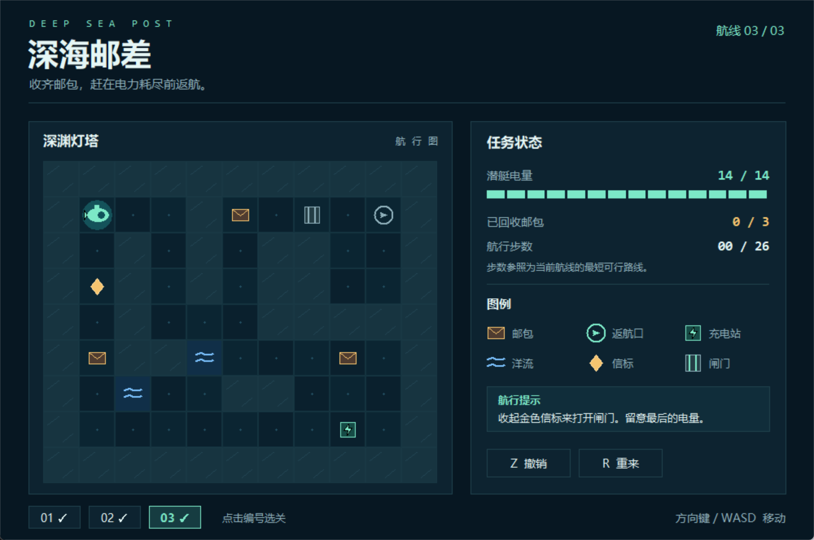

# 深海郵便 / Deep Sea Post

潜水艇を操作し、電池が切れる前にすべての郵便物を回収して帰還する、全3ステージのターン制パズルです。第14・15回の最終制作を参考にしたオリジナル作品のデモです。ゲーム画面の表示言語は中国語です。

## 動作環境・インストール

- Python 3.10 以上（標準モジュールの Tkinter を使用）
- Windows で動作確認済み
- VS Code はソースコードの閲覧・編集に使用できます

外部ライブラリのインストールは不要です。Tkinter の有無は `py -m tkinter` で確認できます。確認用のウィンドウが表示されたら閉じてください。

## 起動方法

ZIPを展開し、`main.py` があるフォルダーを VS Code で開きます。「ターミナル → 新しいターミナル」を開いて、次のコマンドを実行します。

```powershell
py main.py
```

`py` が見つからない環境では `python main.py` を実行します。別ウィンドウにゲームが表示されます。

## 操作・ルール

| キー | 操作 |
| --- | --- |
| 矢印キー / W A S D | 上下左右へ1マス移動 |
| Z / Backspace | 直前の1手を取り消す |
| R | 現在のステージを最初からやり直す |
| 1 / 2 / 3 | ステージを選ぶ |
| Enter | クリア後、次のステージへ進む |

封筒をすべて回収すると帰還口に入れます。通常の移動は電池を1目盛り、青い海流マスへの移動は3目盛り消費します。充電所はステージ中に一度だけ使えます。金色のビーコンを拾うとゲートが開きます。岩や閉じたゲートに阻まれた場合は、電池も手数も消費しません。

## 実装した機能

1. **電池と海流** — `Game.move()` が移動先に応じて消費量を決め、電池切れと帰還を判定します。
2. **一度きりの充電所とゲート** — 使用済みの充電所を状態に記録し、ビーコンの回収とゲートの開閉を連動させます。
3. **手順の取り消し** — 移動前の状態を履歴に保存し、位置、電池、回収物、充電所、ゲートをまとめて1手前へ戻します。電池切れの後も使用できます。
4. **3つの航路と手数表示** — 下部の番号から航路を選べます。最短のクリア手数を目安として表示し、クリア済みの航路にチェックを付けます。

## コードの構成

- `game.py` — マップ文字列、状態、移動・勝敗・取り消しの処理
- `main.py` — Tkinter の画面描画、キーボード・マウス操作、ステージの切り替え

## 実行画面



## 制限事項

ベスト記録とクリアマークは、ウィンドウを閉じると消えます。固定サイズのデスクトップウィンドウを使用します。

## クレジット

ベースゲームはオリジナル作品です。マップ、ルール、アイコンはこのデモ用に作成しました。外部画像・音楽は使用していません。初版のコードと説明は Codex が作成しました。
